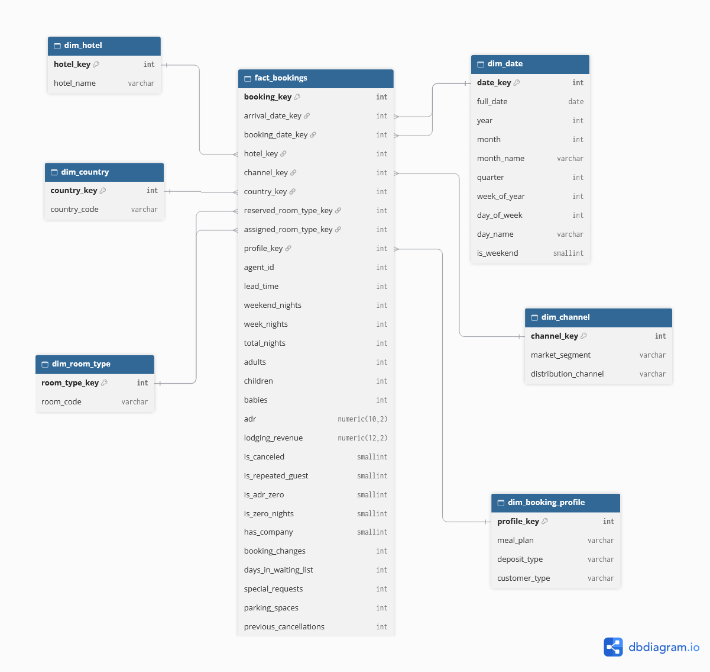

# Modelo dimensional

Modelo em **star schema** no schema `mart` do PostgreSQL, desenhado para responder as perguntas de negócio do projeto (ocupação, ADR, cancelamentos e receita perdida).

## Granularidade

**Uma linha por reserva** na tabela `fact_booking`.

A base de origem não possui um identificador de reserva, então `booking_key` é uma chave surrogate gerada no carregamento.

## Tabela fato

### mart.fact_booking

| Grupo | Colunas |
|---|---|
| Chave primária | `booking_key` |
| Chaves estrangeiras | `arrival_date_key`, `booking_date_key`, `hotel_key`, `channel_key`, `country_key`, `reserved_room_type_key`, `assigned_room_type_key`, `profile_key` |
| Medidas aditivas | `total_nights`, `weekend_nights`, `week_nights`, `adults`, `children`, `babies`, `lodging_revenue` |
| Medidas não aditivas | `adr`, `lead_time` |
| Indicadores (0/1) | `is_canceled`, `is_repeated_guest`, `is_adr_zero`, `is_zero_nights`, `has_company` |
| Outros atributos | `agent_id`, `booking_changes`, `days_in_waiting_list`, `special_requests`, `parking_spaces`, `previous_cancellations` |

`lodging_revenue` é calculada como `adr × total_nights`. É a medida base para a análise de receita perdida com cancelamentos.

## Dimensões

| Tabela | Descrição | Chave natural (única) |
|---|---|---|
| `dim_date` | Calendário de 2013 a 2017 | `full_date` |
| `dim_hotel` | Tipo de hotel (Resort ou City) | `hotel_name` |
| `dim_channel` | Segmento de mercado e canal de distribuição | `market_segment` + `distribution_channel` |
| `dim_country` | País de origem do hóspede (código ISO) | `country_code` |
| `dim_room_type` | Tipo de quarto (códigos anonimizados) | `room_code` |
| `dim_booking_profile` | Refeição, tipo de depósito e tipo de cliente | `meal_plan` + `deposit_type` + `customer_type` |

## Decisões de modelagem

**Dimensões com papel duplo (role-playing).** `dim_date` é usada duas vezes na fato: data de chegada (`arrival_date_key`) e data da reserva (`booking_date_key`, calculada como chegada menos `lead_time`). `dim_room_type` também: quarto reservado e quarto atribuído, o que permite analisar upgrades e mudanças.

**Chave da `dim_date` no formato YYYYMMDD.** Diferente das demais dimensões, a chave é calculada a partir da data (por exemplo, 20160715). Assim o ETL preenche as chaves de data sem precisar consultar a dimensão linha a linha. O calendário começa em 2013 porque `lead_time` chega a mais de 700 dias, então existem reservas feitas antes de 2015.

**Dimensão "lixo" (junk dimension).** `meal_plan`, `deposit_type` e `customer_type` são atributos descritivos de baixa cardinalidade. Em vez de três tabelas minúsculas, reuni as combinações em `dim_booking_profile`.

**`agent_id` na fato (dimensão degenerada).** O dataset só fornece o ID do agente, sem nome ou outros atributos. Uma `dim_agent` teria uma única coluna útil, então o ID fica na fato, com 0 representando reservas sem agente.

**Flags em `SMALLINT` (0/1).** Permitem calcular taxas diretamente (`AVG(is_canceled)`), sem conversões de tipo.

**Flags no lugar de remoção.** Reservas com `adr = 0` e com 0 noites foram mantidas e sinalizadas (`is_adr_zero`, `is_zero_nights`), para que cada análise decida se as inclui. Veja `problemas_qualidade.md`.

**Colunas fora do modelo.**
- `reservation_status` e `reservation_status_date`: só são conhecidas após o desfecho da reserva e são redundantes com `is_canceled`. Usá-las no modelo preditivo causaria vazamento de